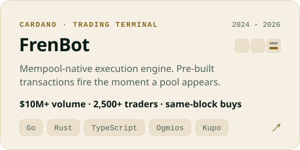
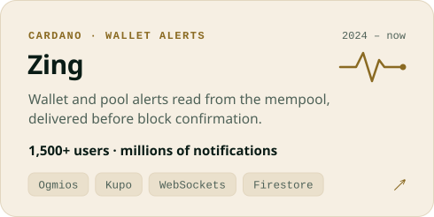
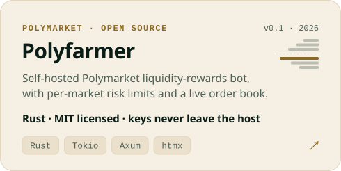
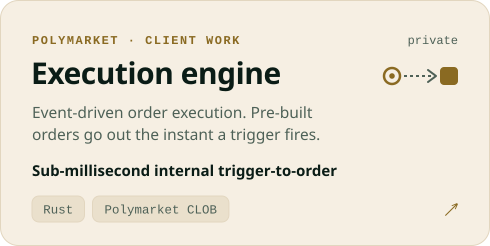
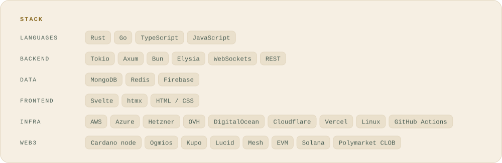

<picture>
  <source media="(prefers-color-scheme: dark)" srcset="assets/header-dark.svg">
  
</picture>

<a href="https://rushlabs.io/work/frenbot"><picture><source media="(prefers-color-scheme: dark)" srcset="assets/card-frenbot-dark.svg"></picture></a>
<a href="https://rushlabs.io/work/mempool-alerts"><picture><source media="(prefers-color-scheme: dark)" srcset="assets/card-zing-dark.svg"></picture></a>
<a href="https://github.com/Vayz0001/polyfarmer"><picture><source media="(prefers-color-scheme: dark)" srcset="assets/card-polyfarmer-dark.svg"></picture></a>
<a href="https://rushlabs.io"><picture><source media="(prefers-color-scheme: dark)" srcset="assets/card-execution-dark.svg"></picture></a>

<picture>
  <source media="(prefers-color-scheme: dark)" srcset="assets/stack-dark.svg">
  
</picture>

<samp>Open to contract work and trading-infrastructure roles · Discord <b>vayzzz</b> · <a href="https://rushlabs.io">rushlabs.io</a></samp>

