<picture><source media="(prefers-color-scheme: dark)" srcset="assets/header-dark.06e0b10.svg"></picture>

<a href="https://rushlabs.io/work/frenbot"><picture><source media="(prefers-color-scheme: dark)" srcset="assets/card-frenbot-dark.06e0b10.svg"></picture></a><a href="https://rushlabs.io/work/mempool-alerts"><picture><source media="(prefers-color-scheme: dark)" srcset="assets/card-zing-dark.06e0b10.svg"></picture></a>
<a href="https://rushlabs.io/work/onchain-infrastructure"><picture><source media="(prefers-color-scheme: dark)" srcset="assets/card-dataapi-dark.06e0b10.svg"></picture></a><a href="https://rushlabs.io"><picture><source media="(prefers-color-scheme: dark)" srcset="assets/card-launchpad-dark.06e0b10.svg"></picture></a>
<a href="https://github.com/Vayz0001/polyfarmer"><picture><source media="(prefers-color-scheme: dark)" srcset="assets/card-polyfarmer-dark.06e0b10.svg"></picture></a><a href="https://rushlabs.io"><picture><source media="(prefers-color-scheme: dark)" srcset="assets/card-execution-dark.06e0b10.svg"></picture></a>

<a href="https://ctf-mumbai.buidlguidl.com/leaderboard"><picture><source media="(prefers-color-scheme: dark)" srcset="assets/award-dark.06e0b10.svg"></picture></a>

<picture><source media="(prefers-color-scheme: dark)" srcset="assets/stack-dark.06e0b10.svg"></picture>

<a href="https://rushlabs.io"><picture><source media="(prefers-color-scheme: dark)" srcset="assets/footer-dark.06e0b10.svg"></picture></a>
