<picture><source media="(prefers-color-scheme: dark)" srcset="assets/header-dark.3e165e8.svg"></picture>

<a href="https://rushlabs.io/work/frenbot"><picture><source media="(prefers-color-scheme: dark)" srcset="assets/card-frenbot-dark.3e165e8.svg"></picture></a><a href="https://rushlabs.io/work"><picture><source media="(prefers-color-scheme: dark)" srcset="assets/card-execution-dark.3e165e8.svg"></picture></a>

<a href="https://rushlabs.io/work/mempool-alerts"><picture><source media="(prefers-color-scheme: dark)" srcset="assets/card-zing-dark.3e165e8.svg"></picture></a><a href="https://rushlabs.io/work"><picture><source media="(prefers-color-scheme: dark)" srcset="assets/card-polyzing-dark.3e165e8.svg"></picture></a>

<a href="https://rushlabs.io/work/onchain-infrastructure"><picture><source media="(prefers-color-scheme: dark)" srcset="assets/card-dataapi-dark.3e165e8.svg"></picture></a><a href="https://github.com/Vayz0001/polyfarmer"><picture><source media="(prefers-color-scheme: dark)" srcset="assets/card-polyfarmer-dark.3e165e8.svg"></picture></a>

<a href="https://ctf-mumbai.buidlguidl.com/leaderboard"><picture><source media="(prefers-color-scheme: dark)" srcset="assets/award-dark.3e165e8.svg"></picture></a>

 <code>vayzzz</code>&nbsp;&nbsp;·&nbsp;&nbsp; <a href="https://rushlabs.io">rushlabs.io</a>

