<picture><source media="(max-width: 767px) and (prefers-color-scheme: dark)" srcset="assets/header-m-dark.4352585.svg"><source media="(max-width: 767px)" srcset="assets/header-m-light.4352585.svg"><source media="(prefers-color-scheme: dark)" srcset="assets/header-dark.4352585.svg"></picture>

<a href="https://github.com/rushlabs-ai"><picture><source media="(max-width: 767px) and (prefers-color-scheme: dark)" srcset="assets/lab-m-dark.4352585.svg"><source media="(max-width: 767px)" srcset="assets/lab-m-light.4352585.svg"><source media="(prefers-color-scheme: dark)" srcset="assets/lab-dark.4352585.svg"></picture></a>

<picture><source media="(max-width: 767px) and (prefers-color-scheme: dark)" srcset="assets/path-m-dark.4352585.svg"><source media="(max-width: 767px)" srcset="assets/path-m-light.4352585.svg"><source media="(prefers-color-scheme: dark)" srcset="assets/path-dark.4352585.svg"></picture>

<a href="https://ctf-mumbai.buidlguidl.com/leaderboard"><picture><source media="(max-width: 767px) and (prefers-color-scheme: dark)" srcset="assets/award-m-dark.4352585.svg"><source media="(max-width: 767px)" srcset="assets/award-m-light.4352585.svg"><source media="(prefers-color-scheme: dark)" srcset="assets/award-dark.4352585.svg"></picture></a>

 <code>vayzzz</code>&nbsp;&nbsp;·&nbsp;&nbsp; <a href="https://rushlabs.ai">rushlabs.ai</a>

