<picture><source media="(max-width: 767px) and (prefers-color-scheme: dark)" srcset="assets/header-m-dark.efe6f88.svg"><source media="(max-width: 767px)" srcset="assets/header-m-light.efe6f88.svg"><source media="(prefers-color-scheme: dark)" srcset="assets/header-dark.efe6f88.svg"></picture>

<a href="https://rushlabs.io/work/frenbot"><picture><source media="(max-width: 767px) and (prefers-color-scheme: dark)" srcset="assets/card-m-frenbot-dark.efe6f88.svg"><source media="(max-width: 767px)" srcset="assets/card-m-frenbot-light.efe6f88.svg"><source media="(prefers-color-scheme: dark)" srcset="assets/card-frenbot-dark.efe6f88.svg"></picture></a><a href="https://rushlabs.io/work/polymarket-execution"><picture><source media="(max-width: 767px) and (prefers-color-scheme: dark)" srcset="assets/card-m-execution-dark.efe6f88.svg"><source media="(max-width: 767px)" srcset="assets/card-m-execution-light.efe6f88.svg"><source media="(prefers-color-scheme: dark)" srcset="assets/card-execution-dark.efe6f88.svg"></picture></a>

<a href="https://rushlabs.io/work/zing"><picture><source media="(max-width: 767px) and (prefers-color-scheme: dark)" srcset="assets/card-m-zing-dark.efe6f88.svg"><source media="(max-width: 767px)" srcset="assets/card-m-zing-light.efe6f88.svg"><source media="(prefers-color-scheme: dark)" srcset="assets/card-zing-dark.efe6f88.svg"></picture></a><a href="https://rushlabs.io/work/polyzing"><picture><source media="(max-width: 767px) and (prefers-color-scheme: dark)" srcset="assets/card-m-polyzing-dark.efe6f88.svg"><source media="(max-width: 767px)" srcset="assets/card-m-polyzing-light.efe6f88.svg"><source media="(prefers-color-scheme: dark)" srcset="assets/card-polyzing-dark.efe6f88.svg"></picture></a>

<a href="https://rushlabs.io/work/chain-data-api"><picture><source media="(max-width: 767px) and (prefers-color-scheme: dark)" srcset="assets/card-m-dataapi-dark.efe6f88.svg"><source media="(max-width: 767px)" srcset="assets/card-m-dataapi-light.efe6f88.svg"><source media="(prefers-color-scheme: dark)" srcset="assets/card-dataapi-dark.efe6f88.svg"></picture></a><a href="https://github.com/Vayz0001/polyfarmer"><picture><source media="(max-width: 767px) and (prefers-color-scheme: dark)" srcset="assets/card-m-polyfarmer-dark.efe6f88.svg"><source media="(max-width: 767px)" srcset="assets/card-m-polyfarmer-light.efe6f88.svg"><source media="(prefers-color-scheme: dark)" srcset="assets/card-polyfarmer-dark.efe6f88.svg"></picture></a>

<a href="https://ctf-mumbai.buidlguidl.com/leaderboard"><picture><source media="(max-width: 767px) and (prefers-color-scheme: dark)" srcset="assets/award-m-dark.efe6f88.svg"><source media="(max-width: 767px)" srcset="assets/award-m-light.efe6f88.svg"><source media="(prefers-color-scheme: dark)" srcset="assets/award-dark.efe6f88.svg"></picture></a>

 <code>vayzzz</code>&nbsp;&nbsp;·&nbsp;&nbsp; <a href="https://rushlabs.io">rushlabs.io</a>

